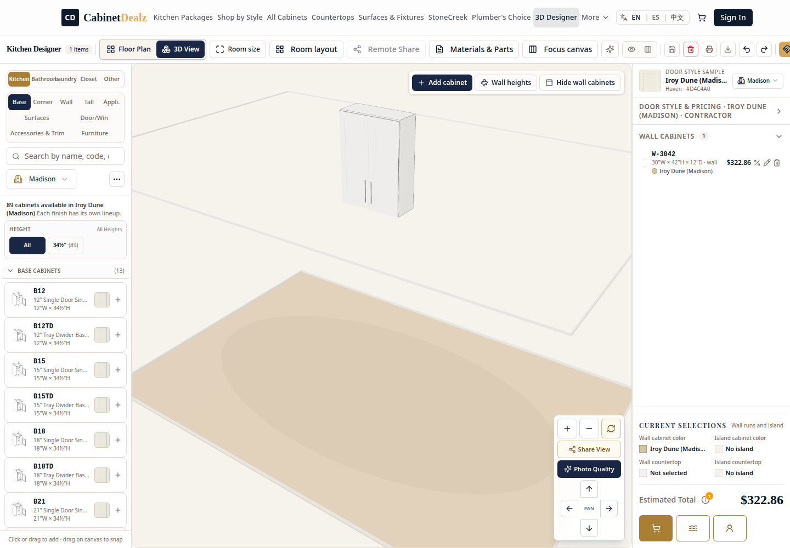

# W3042 Pricing-Tier Correction Proof

**Date:** 2026-10-01 09:18 CT  
**Scope:** Correct a legacy Designer draft that labelled a **Homeowner** price as **Contractor**.

## Cause

Older browser drafts persisted `tier: "retail"`. The current Designer only recognizes `Homeowner`, `Contractor`, and `Wholesale`.

At runtime, `retail` fell through the tier label UI to **Contractor**, but the shared price resolver treated it as the default **Homeowner** branch. The result was a mismatched label and amount for the same cabinet.

## Correction

A shared normalizer maps legacy `retail` to `Homeowner` before it enters Designer pricing state. All current valid tier values are preserved. No distributor SKU, source list price, cost, margin, or customer price was changed.

## Source-backed W3042 reference

| Selected line | Homeowner | Contractor |
|---|---:|---:|
| Madison · Haven Dune · W-3042 | $395.44 | $322.86 |

## Browser verification

| Persisted draft tier | Restored tier shown | W3042 price shown | Result |
|---|---|---:|---|
| `retail` | Homeowner | $395.44 | Passed |
| `Contractor` | Contractor | $322.86 | Passed |

## Automated validation

- TypeScript: passed.
- `designPricingTier` unit regression: 3/3 passed.
- Catalog grouping regression: 5/5 passed.
- Production build and `git diff --check`: passed.
