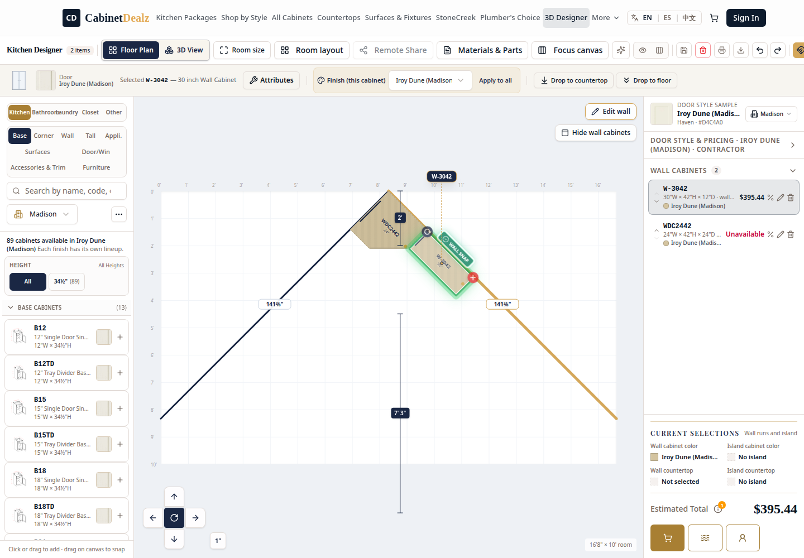

# WDC2442 → W3042 Shared Wall-Run Seam Proof

**Date:** 2026-10-01 07:50 CT  
**Scope:** Fix the false rejection when a W3042 wall cabinet is moved to the exposed side of a WDC2442 diagonal wall corner on a measured 45° Wall Builder run.

## Cause

The shared wall-run engine correctly reserved the WDC2442's **24-inch** catalog leg and seated W3042 at run offset **24 in**. A later generic, axis-aligned screen-envelope seam pass then interpreted the rotated diagonal corner's bounding box as overlap and moved W3042 backward to offset **23 in**. That created a real 1-inch overlap and caused the placement rejection shown in the report.

## Correction

`client/src/lib/design.ts` now carries the room/run context into the final seam normalizer. When two same-layer cabinets are already at an exact zero-gap seam on the **same drawn wall run**, the geometric run seam is authoritative and the second screen-envelope correction is skipped. Real collisions remain blocked normally.

The shared correction is used by:

- Floor Plan drag and nudge (`cabinetWallMovePreview`)
- 3D/right-drag (`cabinetWallDragPreview`)
- Catalog and 3D catalog placement finalization
- Rotation and size-adjustment seam normalization

No catalog, pricing, invoice, or cabinet dimensions were changed.

## Local Browser Proof

- **Room:** two 141 3/8-inch measured 45° runs meeting at the WDC2442 vertex.
- **Corner:** WDC2442 owns Wall 6 at offset 0 in.
- **Action:** drag W3042 from 30 in toward the corner on Wall 6.
- **Expected / actual W3042 offset:** **24 in / 24 in**
- **Gap:** **0 in**
- **Overlap:** **0 in**
- **Snap confirmation:** displayed

## Live Verification

At **07:53 CT**, cache-busted `www.cabinetdealz.com` served the published
`DesignTool-KVRfetxe.js` bundle. The exact same Floor Plan drag was run against
the live Designer and persisted the following result:

| Check | Live result |
|---|---:|
| WDC2442 Wall 6 leg | 24 in |
| W3042 Wall 6 offset after drag | 24 in |
| Difference | 0 in |
| Wall/run identity | `down-right` / 45° |
| Snap confirmation | Visible |

## Regression Coverage

- `client/src/lib/design.test.ts` now proves both exposed WDC2442 legs: the prior right-drag leg and the reported Floor Plan/catalog leg at offset 24 in.
- `client/src/lib/oneEngineWallParity.test.ts` verifies shared standard/drawn wall movement.
- `client/src/pages/DesignTool.universalCabinetAdjacency.test.ts` verifies catalog and designer action routing through the common seam normalizer.
